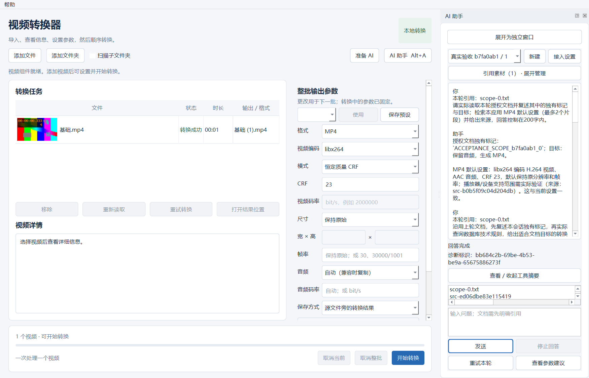

# Windows 视频转换器

源码仓库：[daninyc/windows-video-converter-agent](https://github.com/daninyc/windows-video-converter-agent)。

Windows / PySide6 桌面视频转换器：导入、信息与缩略图、MP4 / MKV / WebM 转换、顺序队列、取消与重试；附有 Agent、多轮历史、stdio MCP、MySQL、Qdrant 混合检索与 CPU 重排。

Windows 本机人工操作与媒体播放已获用户确认。真实 DeepSeek 五会话各三轮的目标验收、报告审计，以及打包桌面重启后的历史追问已通过；失败尝试和修复均保留。RAG 人工标签、干净 Windows 和二进制分发许可仍待核对。实际结果见 [测试总表](docs/TEST_REPORT.md)、[真实模型报告](docs/LIVE_MODEL_REPORT.md) 和 [会话记录](docs/SESSION_SUMMARY.md)。

想了解这个项目怎样借助 AI 推进，可阅读根目录的 **[AI 协作开发复盘](AI协作开发复盘.md)**：以对话还原需求决策、Spec、任务拆分、人工反馈和排障，并提供可复用的提示词。



截图来自实际打包客户端，使用合成视频和测试文档，展示已保存的会话历史。

## 直接验收

本机双击项目根目录 **`启动验收.cmd`**，无需激活 Python。入口读取 `artifacts/review-target.json`，启动已实测的打包 EXE 和独立验收数据目录。详细操作、测试视频绝对位置、判断标准与反馈格式见 **[真人验收流程](docs/ACCEPTANCE.md)**。

本机最新候选包在 `dist/live-ready-wmi/MediaConverter-Windows-x64.zip`，解压后运行整个 `MediaConverter` 文件夹中的 EXE；保留 `_internal`、`bin` 等文件夹。核心不要求系统装 Python / FFmpeg。需要 AI 时将同目录的 `MediaConverter-AI-Windows-x64.zip` 和 `MediaConverter-AI-manifest.json` 放在 EXE 旁边，在向导准备本地组件；组件与模型需要下载或校验缓存。ZIP 不含 Key、数据库或模型权重。源码仓库不包含本机生成的 `dist`、`artifacts` 或运行数据，新克隆按下方源码说明准备。

本机人工核对与本轮在线目标验收已通过。候选包的 `release_ready=false`，分发许可和独立机验收未完成，暂作本地审阅；源码提交与二进制 Release 分开处理。

## 本机启动

这是当前工作区的启动方式；新克隆环境按 [源码环境准备](docs/SOURCE_SETUP.md) 操作，不能假定生成的 `environment` 已存在。

在项目根目录的 PowerShell 7.4+ 执行：

```powershell
Set-Location 'D:\CodexWorkspace\bossjinzhoubishiti'
. .\environment\activate.ps1
python -m media_converter
```

复用已有隔离环境，不需要重新下载模型。已完成 editable 安装；若移动源码后需重新安装，先加载上述环境，再执行 `python -m pip install --no-deps --no-build-isolation -e .`。运行数据默认写入项目 `data`，可用 `--data-dir` 注入独立目录。GUI 启动不要求 AI 服务，不导入 Torch，不调用在线模型。

使用时添加视频，选择统一输出目录或源文件旁的“转换结果”，设置目标格式并点击“开始转换”。不保留的轨道必须在清单中确认。一个文件失败会继续其他项；“取消当前”继续后项，“取消整批”不再启动后项。重试沿用该次原参数，设置面板的更改用于下一批。源文件和已有结果不被覆盖。

程序记住有效设置和命名预设，重启重新校验本机能力。任务状态保存在 `data/state.sqlite3`，脱敏事件保存在 `data/events.jsonl`；同一数据目录同时只允许一个实例。退出会停止所属转换并保存状态；不会自动重跑中断任务。

## AI 助手

本机需要本地检索/数据库时，先运行 `.\environment\start-services.ps1`。配置和知识库已在本机准备好；组件复用命令如下，不会下载模型：

```powershell
python -m media_converter.devtools configure-ai --environment-root environment --data-dir data
python -m media_converter.devtools knowledge-build --root knowledge --data-dir data
python -m media_converter.devtools sync-mysql --data-dir data
```

点击“准备 AI”先检查本地能力，再选择复用或准备当前目录的私有组件。向导显示来源、空间和处理阶段，可取消、重试；关闭页面后准备继续，重开沿用原操作。API 接入和显式连接测试从向导或助手的“接入设置”进入。认证/额度失败会阻止同一配置继续发起在线请求，修正配置或显式测试成功后恢复。本机评审配置已接入真实模型；新克隆或其他 Windows 用户需自行配置。Key 以当前 Windows 用户 DPAPI 密文保存，可替换/清除，搬到别的用户/机器需重新配置。

发送前展开“引用素材”管理视频/任务/文档范围，主列表选中变化不会偷换已发送轮次的引用。TXT/MD/LOG/PDF/DOCX 仅可按已授权引用读取。侧栏、浮窗共用历史；关闭浮窗不停止回答，“停止回答”才取消本轮。参数建议需查看差异并勾选确认，仅改下一批，仍由用户主动开始转换。工具摘要和诊断标识可在助手中查看；“帮助 → 查看 / 导出本地诊断”生成白名单 ZIP，不打包数据库、密钥、文档或视频，不上传。

## 已实现的开发命令

```powershell
python -m media_converter.devtools --help
python -m media_converter.devtools prepare --components core --data-dir data
python -m media_converter.devtools prepare --components ai --mode reuse --data-dir data
python -m media_converter.devtools doctor --require all-local --data-dir data --output artifacts/reports/doctor-local.json
python -m media_converter.devtools fixtures --profile smoke --root artifacts/fixtures --data-dir data
python -m pip check
python -m ruff check src tests
python -m ruff format --check src tests
python -m pytest tests/unit tests/gui tests/integration -q --fixture-root artifacts/fixtures --data-dir data --xiph-root artifacts/fixtures/xiph --junitxml artifacts/reports/boundary-final.xml
```

`prepare --components core` 优先检查已有二进制，缺失时从固定清单准备并校验。默认查找便携包 `bin`、本机 `D:\ffmpeg_ffprobe`（开发目录存在时）及 PATH；也可用 `--ffmpeg`、`--ffprobe` 指定绝对路径，或配置 `data/toolchain.json` 的同名字段。相对配置路径相对于应用目录。检查包括文件身份、SHA-256、版本、编码器及封装能力；不会静默切换缺失编码器。

私有准备使用新的数据目录，例如 `python -m media_converter.devtools prepare --components ai --mode private --data-dir artifacts/private-ai-045`。不会覆盖已有外部配置或重置现有数据库。模型、下载、缓存、临时文件和服务 profile 放在该数据目录；优先复用已验证的项目缓存，剩余下载支持续传。CLI 完成实际检查后关闭所属私有服务；以后通过 GUI 重新打开该数据目录时，在向导选择“复用已配置的本地组件”或“私有组件”均会恢复所属服务。纯外部配置的复用仍要求外部服务先运行。GUI 正常退出也会关闭所属服务，外部复用服务继续运行。

独立 AI 运行时使用冻结 worker，MCP、文档解析和 CPU 重排通过同一入口路由；缺失 / 损坏组件会提示准备，不能悄悄借用开发 Python。向导不调用在线模型，只有主动连接测试或发送问题才请求在线接入。新目录、隔离 PATH 的自动结果与干净 Windows 的未测边界见测试总表。

`fixtures --profile smoke` 生成 22 个自有样本和 manifest：五种视频封装、轨道/字幕/旋转/变帧率/超短/坏文件，TXT/MD/LOG/PDF/DOCX 与文档异常案例。manifest 记录命令、期望流/时间基、实测信息和哈希。再次执行校验后复用；文件被改动或目录含非本工具文件时明确拒绝覆盖。加密 PDF 的 `fixture-only` 仅为测试口令。`--profile pressure` 另生成 30 分钟 1080p、1 分钟 4K 和 50 个短样本；都是明确标注的合成内容。

另有 [Xiph Crowd Run 真实素材测试](docs/XIPH_TEST.md)：完整 1080p50、500 帧的 Y4M 输入，经现有业务流程转换为 MP4。已补齐 `.y4m` 文件/目录导入和文件选择过滤器；大素材需按说明单独下载，再以 `--xiph-root` 显式启用测试，默认测试跳过此项。

测试默认拦截非 loopback 网络访问；真实在线测试须显式 `--live-api`，会产生真实供应商请求。当前在线执行、失败修复和复测进度见 [真实模型报告](docs/LIVE_MODEL_REPORT.md)。GUI 缩放测试使用真实 Windows Qt 插件，需要可用桌面环境。

收尾命令（推理测试依次执行）：

```powershell
python -m media_converter.devtools build-windows --data-dir data --output dist
python -m media_converter.devtools smoke-package --package dist/MediaConverter-Windows-x64.zip --without-dev-path --output artifacts/reports/package-smoke.json
python -m media_converter.devtools eval-rag --dataset knowledge/eval.jsonl --data-dir data --output artifacts/reports/rag-eval.json
python -m media_converter.devtools bench-mcp --profile real-local --requests 100 --client-concurrency 100 --rounds 3 --faults --data-dir data --output artifacts/reports/mcp-real-local.json
python -m media_converter.devtools fixtures --profile pressure --root artifacts/fixtures/pressure --data-dir data
python -m media_converter.devtools bench-video --profile agreed --fixture-root artifacts/fixtures/pressure --data-dir data --output artifacts/reports/video-pressure.json
python -m pytest tests/unit tests/gui tests/integration -q --data-dir data --fixture-root artifacts/fixtures --xiph-root artifacts/fixtures/xiph --junitxml artifacts/reports/closing-regression.xml
```

真实在线命令和人工反馈模板见验收文档第 9 节。请不要在离线人工确认前执行 `--live-api`。

## 交接资料

- [基础验收记录](docs/FOUNDATION_REPORT.md)：逐票范围、接口、命令、结果和限制。
- [转换闭环验收记录](docs/CONVERSION_REPORT.md)：95 项通过、三目标真实桌面操作、输出/截图与未验证范围。
- [Xiph 外部素材补充测试](docs/XIPH_TEST.md)：来源、许可、固定哈希、复现命令与实测记录。
- [Agent 本地开发验收](docs/AGENT_REPORT.md)：020–039、145 项联合结果、真实本地组件与模拟供应商边界。
- [040 文件系统边界](docs/FILESYSTEM_REPORT.md)：46 项通过、故障注入、输出保护和本机长路径限制。
- [041–047 边界与桌面记录](docs/BOUNDARY_REPORT.md)：完整实测、准备/健康检查命令、失败修复、截图与后续限制。
- [视觉参考与截图说明](docs/UI_REFERENCE.md)。
- [依赖组与锁文件](docs/DEPENDENCIES.md)。
- [会话与决策记录](docs/SESSION_SUMMARY.md)。
- [AI 协作开发复盘与提示词](AI协作开发复盘.md)。
- [真实模型工具选择与多轮验收](docs/LIVE_MODEL_REPORT.md)。
- [规格及后续 tickets](SPEC.md)：已按用户授权推进，真实 API 留到 054。

基础 / AI ZIP 已生成本地验收候选，尚未公开分发。真实摄影短片、合成全队列、实际本地工具和包运行结果有单独证据；未测项目如实保留。第三方组件来源、许可文本与发布前缺口见 [THIRD_PARTY.md](docs/THIRD_PARTY.md)。
